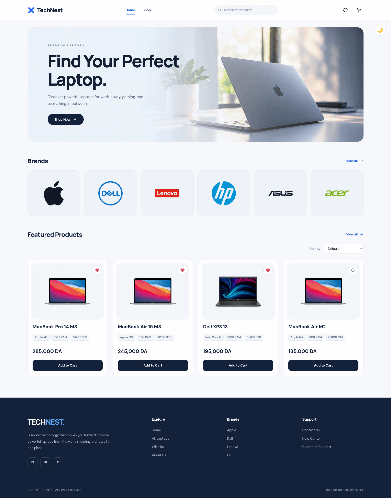

# TechNest – Laptop E-Commerce Store

- **Student Name:** ARZIM Sara
- **Application Name:** TechNest
- **Live Application:** https://ttechnest.netlify.app/

## 2. Application Description

TechNest is a React-based e-commerce application designed for browsing and purchasing laptops from different technology brands.

The application provides a user-friendly interface where customers can explore products, view product details, manage their shopping cart, and save their favorite products to a wishlist.

## 3. Technologies Used

- **React.js** – Building the user interface using reusable components.
- **JavaScript** – Application logic and interactivity.
- **CSS3** – Styling and responsive design.
- **Redux** – Managing global application state.
- **Vite** – Development environment and build tool.
- **HTML5** – Application structure.

## 4. Main React Components

| Component       | Description                                              |
| --------------- | -------------------------------------------------------- |
| `Header`        | Navigation, search, and access to the cart and wishlist. |
| `Hero`          | Homepage introduction and main promotional section.      |
| `Categories`    | Displays available laptop brands.                        |
| `ProductGrid`   | Displays products with sorting options.                  |
| `ProductDetail` | Shows detailed information about a selected laptop.      |
| `Cart`          | Displays and manages shopping cart items.                |

## 5. Redux State Management

Redux is used to manage shared application data.

The main Redux state includes:

- **Cart (`items`):** Stores products added to the shopping cart, including their quantities and selected options.
- **Wishlist (`wishlist`):** Stores the IDs of products saved by the user.

Implemented Redux actions include:

- `ADD_TO_CART`
- `REMOVE_FROM_CART`
- `INCREMENT`
- `DECREMENT`
- `CLEAR_CART`
- `TOGGLE_WISHLIST`

Selectors are used to retrieve cart items, wishlist items, total item count, and subtotal.

## 6. Implemented Features

- Browse laptops from different brands.
- Filter products by brand.
- Search for products by name or brand.
- Sort products by price and name.
- View individual product details.
- Add and remove products from the shopping cart.
- Increase and decrease product quantities.
- Add and remove products from the wishlist.
- Switch between light and dark themes.
- Responsive user interface.

## 7. Screenshots

## Application Screenshots

## Application Screenshots

<p align="center">
  
</p>

## 8. Installation and Running Instructions

### Prerequisites

- Node.js
- npm
- Git

### Clone the repository

```bash
git clone https://github.com/sara-arz/technest
```

### Navigate to the project directory

```bash
cd technest
```

### Install dependencies

```bash
npm install
```

### Start the development server

```bash
npm run dev
```

Open the local URL displayed in your terminal, usually:

```text
http://localhost:5173
```
